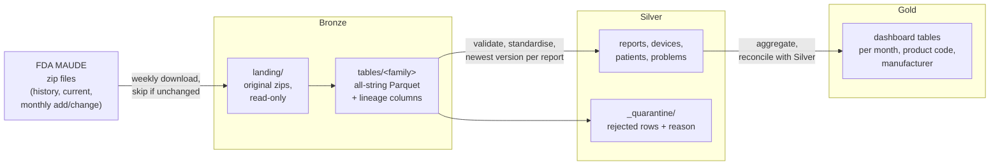

# MAUDE medallion pipeline

**DAT535 project, group 17:** Erik Hafnor and Martin Sævareid Lauritsen, University of Stavanger

We turn the FDA's public MAUDE database of medical device adverse event reports into trusted,
analysis-ready tables with PySpark and a Bronze, Silver and Gold (medallion) architecture. The
Gold tables answer one question for hospital medical-technology departments: which device types
and manufacturers account for reports of deaths, injuries and malfunctions, and how does that
develop over time?

- What we build and why: [docs/project-definition.md](docs/project-definition.md)
- What the source files look like: [docs/source-profile.md](docs/source-profile.md)
- What is left to do: [docs/backlog.md](docs/backlog.md)
- How we work together: [CONTRIBUTING.md](CONTRIBUTING.md)
- AI use disclosure: [docs/ai-use.md](docs/ai-use.md)

## Architecture



Each run writes a quality report (`metrics.json` and `summary.md`) and a log. GitHub Actions shows
the summary on the run page and keeps both as artifacts.

## Quick start

Requirements: Python 3.11 or newer and Java 17.

```bash
git clone https://github.com/erikhafnor/group17.git
cd group17
make venv                        # .venv with PySpark, pytest and ruff
make test                        # unit tests on small synthetic fixtures
make run ENV=dev                 # real FDA monthly files; about 150 MB download
make run ENV=dev STAGE=silver    # rerun one stage
```

On macOS, point Spark at Java 17 first: `export JAVA_HOME=$(/usr/libexec/java_home -v 17)`.

By default, data goes to `~/maude-data/<env>`. Set `MAUDE_DATA_ROOT` to write somewhere else,
for example on a laptop with little free space.

## Repository layout

```text
config/            dev.toml, prod.toml, test.toml: data area, file sets, Spark settings
src/maude/
  sources.py       catalogue of FDA files and which sets each environment ingests
  bronze/          ingest.py (download, checksum, land), parse.py (zip -> Bronze table), manifest.py
  silver/          cleaning.py (shared column rules), reports.py, ...
  gold/            event_counts.py, ...
  pipeline.py      runs the stages and writes the run report
tests/             pytest suite; conftest.py builds fixture zips that reproduce the source quirks
docs/              project definition, source profile, backlog, AI use log
labs/              our completed lab work (Labs 1-3); its workflows are kept for reference only
.github/           workflows and pull request template
```

## Environments and workflows

| | dev | prod |
|---|---|---|
| Configuration | `config/dev.toml` | `config/prod.toml` |
| Source files | lookups + monthly add/change | lookups + history + current year + monthly |
| Data area on the runner | `~/maude-data/dev` | `~/maude-data/prod` |
| GitHub environment | `dev` (no gate) | `main` (approval by the other member) |

| Workflow | Trigger | Runs on |
|---|---|---|
| [CI](.github/workflows/ci.yml) | pull requests and pushes to `dev`/`main` | GitHub-hosted: ruff + pytest |
| [Pipeline (dev)](.github/workflows/pipeline-dev.yml) | push to `dev`, manual | self-hosted runner |
| [Pipeline (prod deploy)](.github/workflows/pipeline-prod.yml) | merge to `main`, manual; needs approval | self-hosted runner |
| [Pipeline (prod schedule)](.github/workflows/pipeline-scheduled.yml) | Mondays 04:00 UTC, manual | self-hosted runner |

The pipeline workflows share one job definition, [_pipeline.yml](.github/workflows/_pipeline.yml).
They run on `group17-runner`, our OpenStack VM with Spark in `/opt/spark`, Java 17 and the
Python environment `~/spark-env`. Pull requests never run on that VM: the repository is public,
so only pushes by collaborators reach it.

## Data source

U.S. Food and Drug Administration, *MAUDE – Manufacturer and User Facility Device Experience*,
[MDR data files](https://www.fda.gov/medical-devices/medical-device-reporting-mdr-how-report-medical-device-problems/mdr-data-files),
and the [product classification database](https://www.fda.gov/medical-devices/classify-your-medical-device/download-product-code-classification-files).
MAUDE reports are passive surveillance data: they can be incomplete, unverified or duplicated,
and report counts say nothing about how often a device fails.
